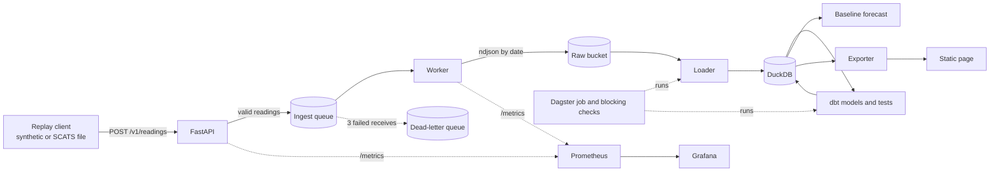

# mini-city-brain


mini-city-brain replays public Victorian traffic-signal volume data as a stream of readings and sends them through an API, a queue and object storage into DuckDB, where dbt models and data-quality checks turn them into busy-hour tables and a simple forecast. It runs on one laptop with Docker and costs nothing.

**Live demo:** [not published yet](docs/demo.md)

## Why this exists

> I built the first version in June 2026 while applying for a backend and cloud role on a transport data platform. It was one file that accepted a JSON record and wrote it to a mock bucket, and nothing read it back. I rebuilt it to learn the parts backend and data roles keep asking for (event-driven ingestion, infrastructure as code, CI, data modelling, orchestration and monitoring) and ran it on real Victorian traffic data instead of hand-typed test records.

## What it answers

When are Melbourne's signalised intersections busiest, and how close does a simple forecast get?

## What is real and what is simulated

| Part | Status |
| --- | --- |
| Source data (Victorian traffic-signal volumes) | Real and public. I download it into `data/raw/` (not in git). Not loaded on the build machine. |
| Test, CI and default demo data | Synthetic, generated with a fixed seed. Anything computed from it is labelled `simulated`. |
| AWS services | A local AWS emulator (Moto). No real cloud account and no real credentials. |
| Replay speed | The replay client posts readings faster than they happened (for example 60x, or as fast as possible). It is a replay, not a live feed. |
| Forecast results | `not measured` on real data. Results on synthetic data are `simulated` and are not quoted here. |
| Demo page | Built from synthetic data unless I set `REAL_DATA_ENABLED`. The page shows which. |

## Architecture



The queues and buckets are created by Terraform pointed at the emulator (`infra/terraform/`).

## See it break on purpose

`make demo-bad` sends a batch with a negative volume and a gap, sends that batch twice, then runs the pipeline. The API rejects the negative reading and says why. The duplicate send reaches the bucket, so a blocking check fails and nothing downstream is built. The command exits non-zero and prints which check failed, on which asset and why:

```
PIPELINE FAILED
------------------------------------------------------------
  check: duplicate_rate
  asset: raw_objects_loaded
  why:   96 of 1800 raw rows repeat a key (rate 0.0533, limit 0.01)
```

That block is from a run on synthetic data, so its numbers are `simulated` (`results/pipeline_synthetic_bad.txt`). `make demo-bad` against Docker has not been run: the build machine had no Docker. Details in [docs/demo.md](docs/demo.md).

## Quick start

Needs Docker, Python 3.13 and `make`.

```
make setup        # virtual environment and pinned dependencies
make demo         # stack up, replay 2 synthetic days for 5 sites, run the pipeline, print URLs
make demo-bad     # the run that fails on purpose
make demo-down    # stop the stack and remove volumes
```

Without Docker you can still run the pipeline and the page on synthetic data:

```
make pipeline     # load, dbt build, blocking checks, into data/warehouse/mcb.duckdb
make site         # writes site/data/summary.json
python -m http.server --directory site 8000
```

Other targets: `make up`, `make down`, `make replay`, `make dagster-ui` (Dagster UI on port 3001), `make preflight`. The API listens on `http://localhost:8000` (docs at `/docs`).

Grafana (profile `obs`) allows anonymous access as a read-only viewer, bound to `127.0.0.1` only. The admin login is `admin` / `admin`, for local use only. Do not expose these ports.

## Run the tests

```
make lint
make test
make preflight
```

Unit tests use an in-process Moto server and need no Docker. [docs/testing.md](docs/testing.md) lists what each level covers and which commands were run on the build machine.

## Project layout

```
services/api/       FastAPI app: ingest, forecast, health, metrics
services/worker/    queue consumer: validates, batches, writes ndjson to object storage
services/common/    reading model, settings, AWS clients, JSON logging
ingest/             SCATS reader, synthetic generator, replay client
warehouse/          loader from object storage into DuckDB
transform/          dbt-duckdb project (staging, marts, tests)
orchestration/      Dagster job, blocking checks, command-line runner
forecast/           two baseline forecasts and their evaluation
infra/terraform/    buckets and queues, pointed at the local emulator
site/               static demo page, exporter, JSON schema
observability/      Prometheus config, Grafana provisioning and dashboard
scripts/            demo, preflight and helper scripts
tests/              pytest suites and a small synthetic fixture
docs/               data, decisions, third-party, testing, demo, AI log
```

## Data and licence

Source: Department of Transport and Planning (Victoria), Traffic Signal Volume Data, listed as CC BY 4.0. I confirm this on the publisher's page before I use real data. Columns, assumptions and attribution text are in [docs/data.md](docs/data.md). Every choice made during the rebuild is in [docs/decisions.md](docs/decisions.md), and every dependency with its licence is in [docs/third-party.md](docs/third-party.md).

Attribution text for real data: "Contains Traffic Signal Volume Data from the Department of Transport and Planning (Victoria), licensed under CC BY 4.0."

## Limits and what is not built

- Real data has not been loaded. The SCATS reader follows the published data dictionary and is tested on synthetic files only. The date format, the missing-value convention and the time zone (read as fixed UTC+10) are unconfirmed.
- No real cloud deployment, no Kubernetes, no Spark.
- The Docker images, the compose stack, the Terraform `init` container, Grafana and `make demo` were not run on the build machine (no Docker). CI is set up to run the first three, but has not run yet.
- The demo page has not been opened in a browser. No map is shown, because no site-locations file has been joined.
- The reading schema carries no alarm field, so detector health uses missing intervals only.
- Forecasts are two simple baselines, not a trained model.

## How AI was used and verified

I used Claude Code for drafting code, writing tests, writing docs. I wrote the goal and acceptance check first, read every change, ran the tests and made every commit myself. Every number in this repo comes from a run I did, and each one is labelled as measured, estimated or simulated.

What I checked: tests, linting, edge cases, package licences from metadata, no credentials in the committed files. Where the tool was wrong, and what I changed, is in [`docs/ai-log.md`](docs/ai-log.md).

## Licence

MIT. See [LICENSE](LICENSE).
