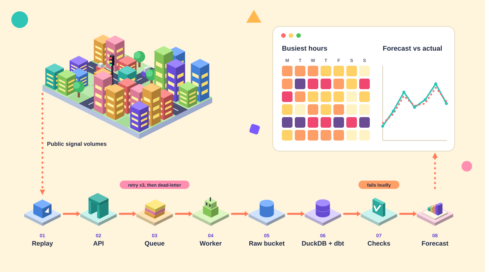
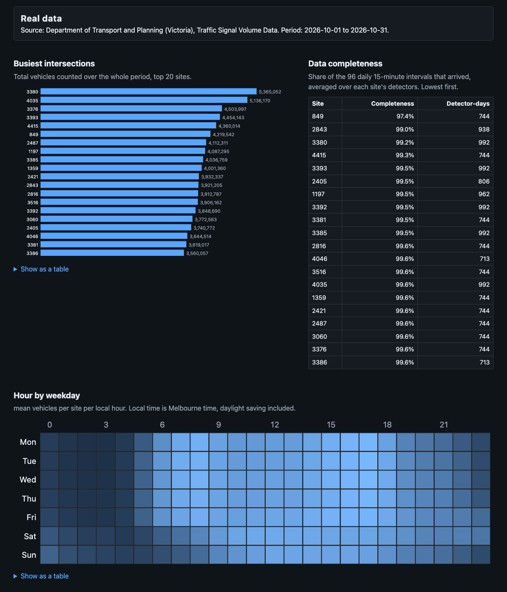
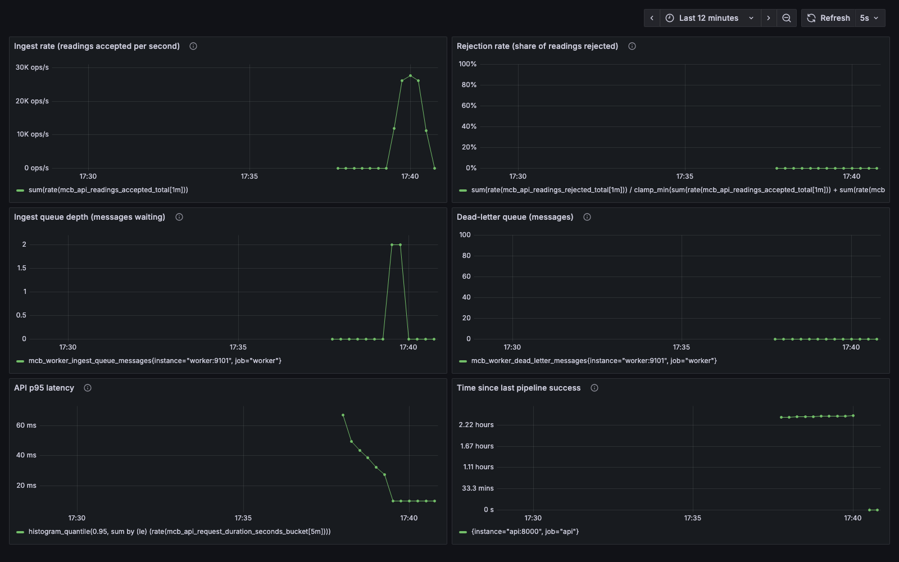
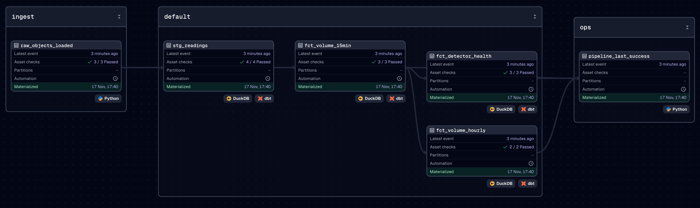
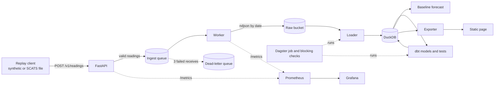
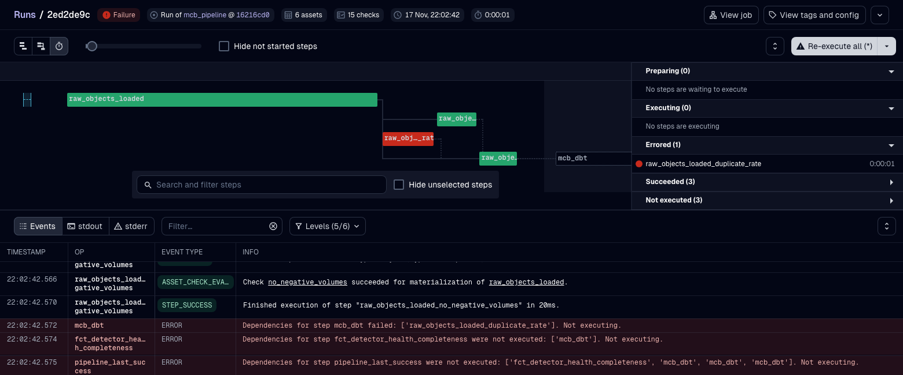

# mini-city-brain


mini-city-brain replays public Victorian traffic-signal volume data as a stream of readings and sends them through an API, a queue and object storage into DuckDB, where dbt models and data-quality checks turn them into busy-hour tables and a simple forecast. It runs on one laptop with Docker and costs nothing.



**Live demo:** <https://cesinata.github.io/mini-city-brain/>. It shows the real October 2026 month for the 20 busiest sites, downloaded and built by the GitHub Pages workflow on 2026-11-17; the banner says whether the data is real or synthetic. How the page is built: [docs/demo.md](docs/demo.md).

## Why this exists

> I built the first version in June 2026 while applying for a backend and cloud role on a transport data platform. It was one file that accepted a JSON record and wrote it to a mock bucket, and nothing read it back. I rebuilt it to learn the parts backend and data roles keep asking for (event-driven ingestion, infrastructure as code, CI, data modelling, orchestration and monitoring) and ran it on real Victorian traffic data instead of hand-typed test records.

## What it answers

When are Melbourne's signalised intersections busiest, and how close does a simple forecast get?

First answer, from one real month: across the 20 busiest signal sites in October 2026, the busiest hour of the week was **Wednesday 17:00 to 18:00 local time, with 176,487 vehicles counted** on average in that hour (`measured (host CPU)`, one run, `results/real_busiest_hour.txt`). On weekdays the peak hour is 17:00, on weekends 12:00.

How close a forecast gets, on the last 7 days of that month: the mean of the same 15-minute interval in earlier weeks was off by **99.9 vehicles per interval per site** (mean absolute error, MAPE 28.2%). Repeating the same interval one week earlier was off by 114.4 (MAPE 30.1%) (`measured (host CPU)`, one run, `results/forecast_eval_real.json`). October gives only 24 days of history before that week, so the "four-week" mean uses at most three earlier weeks.

Contains Traffic Signal Volume Data from the Department of Transport and Planning (Victoria), licensed under CC BY 4.0.

## What it looks like

The demo page on the real October 2026 month: busiest sites, data completeness per site, and vehicles by local hour and weekday.



Grafana while the real month was replayed through the API, queue and worker on my laptop: the ingest rate rises and falls with the replay, nothing is rejected, the dead-letter queue stays empty, and "time since last pipeline success" drops to zero when the pipeline run finishes.



The Dagster asset graph after that run: load from the bucket, the four dbt models and the run record, every asset materialized and every check passed.



All three show the real October 2026 data (contains Traffic Signal Volume Data from the Department of Transport and Planning (Victoria), licensed under CC BY 4.0), captured with headless Chrome on 2026-11-17.

## What is real and what is simulated

| Part | Status |
| --- | --- |
| Source data (Victorian traffic-signal volumes) | Real and public. I download it into `data/raw/` (not in git). One month (October 2026) has run through the whole stack on my laptop: 1,577,675 readings for the 20 busiest sites, all accepted (`measured (host CPU)`, `results/real_replay.txt`). |
| Test, CI and default demo data | Synthetic, generated with a fixed seed. Anything computed from it is labelled `simulated`. |
| AWS services | A local AWS emulator (Moto). No real cloud account and no real credentials. |
| Replay speed | The replay client posts readings faster than they happened (for example 60x, or as fast as possible). It is a replay, not a live feed. |
| Forecast results | One real month, quoted above (`measured (host CPU)`). Results on synthetic data are `simulated` and are not quoted here. |
| Demo page | The live page is built from real data because `REAL_DATA_ENABLED` is set; without it, or if the download fails, it falls back to synthetic data. The page shows which. |

## Architecture



The queues and buckets are created by Terraform pointed at the emulator (`infra/terraform/`).

## See it break on purpose

`make demo-bad` sends a batch with a negative volume and a gap, sends that batch twice, then runs the pipeline. The API rejects the negative reading and says why. The duplicate send reaches the bucket, so a blocking check fails and nothing downstream is built. The command exits non-zero and prints which check failed, on which asset and why:

```
PIPELINE FAILED
------------------------------------------------------------
  check: duplicate_rate
  asset: raw_objects_loaded
  why:   76 of 152 raw rows repeat a key (rate 0.5000, limit 0.01)
Nothing downstream of a failed check was built.
```

That block is from `make demo-bad` against the Docker stack on my laptop on 2026-11-17, started from an empty stack (`results/demo_bad_run.txt`). Each request had 76 readings accepted and 1 rejected for `volume`. The data is synthetic, so the numbers are `simulated`. Details in [docs/demo.md](docs/demo.md).

The same failure in the Dagster UI: the `duplicate_rate` check fails on `raw_objects_loaded`, and dbt and everything after it is not executed.



## Quick start

Needs Docker, Python 3.13 and `make`.

```
make setup        # virtual environment and pinned dependencies
make demo         # stack up, replay 2 synthetic days for 5 sites, run the pipeline, print URLs
make demo-bad     # the run that fails on purpose
make demo-down    # stop the stack and remove volumes
```

Without Docker you can still run the pipeline and the page on synthetic data:

```
make pipeline     # load, dbt build, blocking checks, into data/warehouse/mcb.duckdb
make site         # writes site/data/summary.json
python -m http.server --directory site 8000
```

Other targets: `make up`, `make down`, `make replay`, `make dagster-ui` (Dagster UI on port 3001), `make preflight`. The API listens on `http://127.0.0.1:8000` (docs at `/docs`).

Grafana (profile `obs`) allows anonymous access as a read-only viewer, bound to `127.0.0.1` only. The admin login is `admin` / `admin`, for local use only. Do not expose these ports.

## Run the tests

```
make lint
make test
make preflight
```

Unit tests use an in-process Moto server and need no Docker. [docs/testing.md](docs/testing.md) lists what each level covers and which commands were run on the build machine.

## Project layout

```
services/api/       FastAPI app: ingest, forecast, health, metrics
services/worker/    queue consumer: validates, batches, writes ndjson to object storage
services/common/    reading model, settings, AWS clients, JSON logging
ingest/             SCATS reader, synthetic generator, replay client
warehouse/          loader from object storage into DuckDB
transform/          dbt-duckdb project (staging, marts, tests)
orchestration/      Dagster job, blocking checks, command-line runner
forecast/           two baseline forecasts and their evaluation
infra/terraform/    buckets and queues, pointed at the local emulator
site/               static demo page, exporter, JSON schema
observability/      Prometheus config, Grafana provisioning and dashboard
scripts/            demo, preflight and helper scripts
tests/              pytest suites and a small synthetic fixture
docs/               data, decisions, third-party, testing, demo, media
```

## Data and licence

Source: Department of Transport and Planning (Victoria), Traffic Signal Volume Data, licensed under CC BY 4.0. I checked the licence on the publisher's page on 2026-11-17, before using real data. Columns, assumptions and attribution text are in [docs/data.md](docs/data.md). Every choice made during the rebuild is in [docs/decisions.md](docs/decisions.md), and every dependency with its licence is in [docs/third-party.md](docs/third-party.md).

Attribution text for real data: "Contains Traffic Signal Volume Data from the Department of Transport and Planning (Victoria), licensed under CC BY 4.0."

## Limits and what is not built

- One real month has been loaded (October 2026). It showed that missing intervals are `-1` and that the 96 intervals follow Melbourne clock time with daylight saving, and the reader now reads them that way (decisions D43). The day clocks go back in April has not been checked.
- Real detectors break. In that month 53 of 16,532 detector-days (0.32%) at the 20 sites had fewer than 90% of their intervals, 31 of them from one detector that reports about half the day all month (`measured (host CPU)`, `results/real_completeness_breakdown.txt`). The completeness check now fails a run only when more than 1% of detector-days are incomplete, and prints the incomplete ones as a warning (decisions D45). With the old rule, that one detector failed every real run.
- No real cloud deployment, no Kubernetes, no Spark.
- The Docker stack has run on one machine only (macOS on Apple M3, 2026-11-17): `make demo`, `make demo-bad`, the Terraform `init` container, Prometheus and Grafana on synthetic data (`results/demo_run.txt`, `results/stack_checks.txt`), and the real October month (`results/real_replay.txt`, `results/real_pipeline.txt`). CI runs the compose smoke test on Linux on every push.
- The demo has only 2 days of history, so the forecast endpoint answers but both baselines return `null`: they need at least one earlier week.
- I looked at the Grafana dashboard, the Dagster UI and the API docs on 2026-11-17. That check found two broken Grafana panels (time since last success, rejection-rate axis), which are now fixed (decisions D39). The ingest-rate panel stays flat in `make demo`, because the replay finishes in about a second, faster than Prometheus can see a rate.
- No map is shown, because no site-locations file has been joined (decisions D12).
- The reading schema carries no alarm field, so detector health uses missing intervals only.
- Forecasts are two simple baselines, not a trained model.

## Licence

MIT. See [LICENSE](LICENSE).
